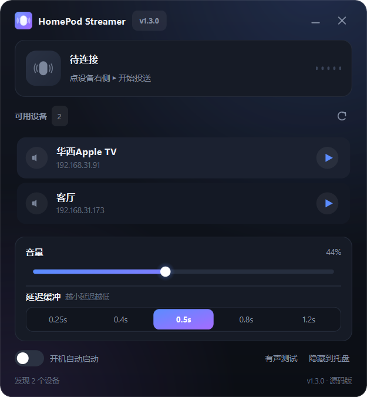

# HomePod Streamer

[](LICENSE)


把 Windows 正在播放的声音，实时投送到 HomePod（AirPlay 2 / RAOP）。

系统音频 → WASAPI 环回采集 → 44.1 kHz 立体声 PCM → ChaCha20 加密 RTP → HomePod。
不需要 ffmpeg，不需要虚拟声卡，单文件源码即可运行。



## 为什么会有这个项目

TuneBlade（2018 年后停更）和 AirParrot 3 在新版 HomePod 固件（27.0 / AirPlay 980.77.2）上都无法再建立连接，
于是用 Python + pyatv 重写了一个专用工具，只做一件事：把系统声音稳定地投给 HomePod，延迟尽量低。

## 功能

- **系统声音实时投送**：抓取 Windows 默认输出设备的环回，任何播放器、浏览器、游戏的声音都会被送出去
- **可调输出缓冲**：5 档（0.25 / 0.4 / 0.5 / 0.8 / 1.2 秒），整条链路延迟约 **0.6 秒**（0.5 s 缓冲时）
- **有声测试**：向音箱播 8 秒提示音（C5-E5-G5-E5-C5），绕开采集端，用来二分定位「没声音」是采集问题还是连接问题
- **自动发现 + 一键连接**：mDNS 扫描局域网内的 AirPlay 设备，点设备行右侧 ▸ 即可连接
- **音量同步**：界面滑块实时调节 HomePod 音量，重启后保持上次的值
- **托盘常驻 + 开机自启**：关闭窗口不退出，右键托盘可显示窗口 / 重连 / 断开 / 退出
- **完整日志**：`%APPDATA%\HomePodStreamer\app.log`，UTF-8，1 MB 自动轮转

## 快速开始（源码运行）

```bash
python -m venv .venv
.venv\Scripts\activate
pip install -r homepod_streamer/requirements.txt
python -m homepod_streamer
```

命令行模式：

```bash
python -m homepod_streamer --scan                 # 只扫描设备
python -m homepod_streamer --name 客厅            # 直接连接指定设备并投送
python -m homepod_streamer --test --name 客厅     # 播放有声测试音
python -m homepod_streamer --minimized            # 隐藏窗口、常驻托盘、自动连上次设备
python -m homepod_streamer --latency 0.4          # 指定输出缓冲（秒）
python -m homepod_streamer --version
```

## 打包

```bash
pip install pyinstaller
python build_exe.py                 # 输出 build/pkg/v<版本>/HomePodStreamer/ 与 dist/*.zip
python build_exe.py --no-zip        # 只打包
python build_exe.py --no-clean      # 复用编译缓存，快一半
```

产物是 **单目录** 形态（`HomePodStreamer.exe` + `_internal\`），不解压到 `%TEMP%`，
启动快、不产生临时垃圾。注意 exe 和 `_internal` 目录必须在一起，不能只拷 exe。

版本号只在 `homepod_streamer/version.py` 里改一处，会自动同步到窗口标题、界面右下角、托盘「关于」、
exe 的 Windows 版本资源和发布压缩包文件名。

## 项目结构

```
homepod_streamer/
  capture.py      WASAPI 环回采集（soundcard）、提示音生成器
  streamer.py     AirPlay/RAOP 引擎：连接、RTP 推流、延迟补丁、缓冲管理
  raw_source.py   原始 PCM 数据源（配合 pyatv 的 stream_file）
  ui.py           全部界面，Qt 控件一律自绘（无图片资源）
  main.py         命令行入口
  version.py      版本号单一来源
  autostart.py    开机自启（注册表 HKCU\...\Run）
  config.py       配置读写（%APPDATA%\HomePodStreamer\config.json）
  README.md       详细说明：延迟构成、故障排查、实现细节
build_exe.py      一键打包 + 生成发布压缩包
```

## 一些实现细节

- **延迟**：pyatv 默认给 RAOP 加 `22050 + sample_rate` = 66150 帧 ≈ 1.5 秒的缓冲，这里打了补丁改成可配置
  （最小 11025 帧 ≈ 0.25 秒）；握手期间积压的音频会在开播前丢弃，否则会永久叠加延迟。
- **采集**：`soundcard` 走 CFFI 直连 WASAPI，能正确处理 `WAVE_FORMAT_EXTENSIBLE`（16 字节 WAVEFORMATEX 截断
  是 pycaw/comtypes 的经典坑）；自动重采样到 44.1 kHz。
- **喂数据**：`soundcard` 的阻塞读取放在 `run_in_executor`，由事件循环内的协程喂给 `StreamReader`；
  跨线程直接 `feed_data` 不可靠（PEER 重置会丢数据）。
- **缓冲策略**：超过 1 秒积压才触发裁剪、裁回 0.5 秒，带滞回避免反复砍掉音频造成断续。

## 依赖注意

```
srptools<2      # 必须锁死：2.0 改成仅关键字参数，pyatv 0.18 仍按位置调用，会连接失败且无任何报错
```

这是最容易踩的坑：`pyatv.connect` 抛 `TypeError: SRPClientSession.__init__() takes 2 positional arguments
but 3 were given`，表现却是「界面显示正在投送、但完全没声音」。

## 兼容性

在 Windows 10/11 + HomePod（AudioAccessory5,1，固件 27.0）上验证通过。
理论上兼容所有支持 RAOP 的 AirPlay 2 音箱，但未逐台测试。

## 许可证

[MIT License](LICENSE) © 2026 Driven92 — 可自由使用、修改、分发、商用，保留版权声明即可。

## 说明

个人自用工具，与 Apple 无关联。使用时请遵守你所在地区的法律法规与设备使用条款。
